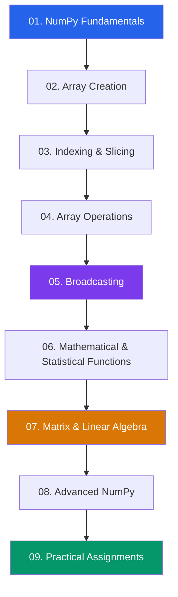

# 🔢 NumPy Assignments — From Fundamentals to Numerical Computing

\<p align="center">   \   \   \   \ \</p>

\<p align="center">   \<b>A hands-on collection of NumPy assignments covering array manipulation, mathematical operations, indexing, broadcasting, and numerical computing.\</b> \</p>

---

## 📌 About This Repository

NumPy (Numerical Python) is one of the fundamental libraries in the Python ecosystem, particularly for Data Science, Machine Learning, and scientific computing.

This repository contains practical assignments designed to develop a strong understanding of NumPy, starting from basic array creation and gradually progressing towards advanced numerical operations.

### 🎯 Learning Objectives

- Understand NumPy arrays and their internal structure.
- Perform mathematical and statistical operations.
- Master array indexing, slicing, and reshaping.
- Understand broadcasting and vectorization.
- Work with matrices and linear algebra.
- Perform efficient numerical computations without relying heavily on Python loops.

---

## 🗺️ Learning Roadmap



---

## 📚 Topics & Important Functions

### 01. NumPy Fundamentals

Introduction to NumPy arrays and their properties.

| Function / Attribute  | Description                                         |
| :-------------------- | :-------------------------------------------------- |
| `np.array()`          | Create a NumPy array                                |
| `np.zeros()`          | Create an array filled with zeros                   |
| `np.ones()`           | Create an array filled with ones                    |
| `np.empty()`          | Create an uninitialized array                       |
| `np.full()`           | Create an array filled with a specific value        |
| `np.arange()`         | Generate evenly spaced values within an interval    |
| `np.linspace()`       | Generate a specified number of evenly spaced values |
| `np.eye()`            | Create an identity matrix                           |
| `np.random.rand()`    | Generate random values from a uniform distribution  |
| `np.random.randint()` | Generate random integers                            |

**Important attributes:**

- `ndim` — Number of dimensions.
- `shape` — Dimensions of an array.
- `size` — Total number of elements.
- `dtype` — Data type of elements.
- `itemsize` — Memory occupied by each element.

### 02. Array Indexing & Slicing

Access and manipulate individual elements and subsets of arrays.

| Function / Operation   | Description                             |
| :--------------------- | :-------------------------------------- |
| `arr[index]`           | Access an element                       |
| `arr[start:stop:step]` | Slice an array                          |
| `arr[row, column]`     | Access matrix elements                  |
| `np.where()`           | Return indices based on a condition     |
| `np.take()`            | Select elements using indices           |
| `np.extract()`         | Extract elements satisfying a condition |
| `np.nonzero()`         | Find indices of non-zero elements       |
| `np.argwhere()`        | Find indices satisfying a condition     |
| `np.flip()`            | Reverse elements along an axis          |

### 03. Array Reshaping & Manipulation

Change the structure and dimensions of arrays.

| Function           | Description                                    |
| :----------------- | :--------------------------------------------- |
| `np.reshape()`     | Change array dimensions                        |
| `np.ravel()`       | Flatten an array into a 1D view where possible |
| `np.flatten()`     | Return a flattened copy                        |
| `np.transpose()`   | Transpose an array                             |
| `np.swapaxes()`    | Exchange two axes                              |
| `np.expand_dims()` | Add a new dimension                            |
| `np.squeeze()`     | Remove dimensions of size one                  |
| `np.concatenate()` | Join arrays along an existing axis             |
| `np.stack()`       | Join arrays along a new axis                   |
| `np.vstack()`      | Stack arrays vertically                        |
| `np.hstack()`      | Stack arrays horizontally                      |
| `np.dstack()`      | Stack arrays along the third axis              |
| `np.split()`       | Split an array into multiple sub-arrays        |
| `np.delete()`      | Delete elements                                |
| `np.insert()`      | Insert elements                                |
| `np.append()`      | Append values                                  |

### 04. Mathematical & Arithmetic Operations

Perform element-wise mathematical computations.

| Function        | Description                 |
| :-------------- | :-------------------------- |
| `np.add()`      | Addition                    |
| `np.subtract()` | Subtraction                 |
| `np.multiply()` | Element-wise multiplication |
| `np.divide()`   | Division                    |
| `np.power()`    | Exponentiation              |
| `np.sqrt()`     | Square root                 |
| `np.square()`   | Square of elements          |
| `np.abs()`      | Absolute values             |
| `np.exp()`      | Exponential function        |
| `np.log()`      | Natural logarithm           |
| `np.log10()`    | Base-10 logarithm           |
| `np.sin()`      | Sine                        |
| `np.cos()`      | Cosine                      |
| `np.tan()`      | Tangent                     |
| `np.round()`    | Round values                |
| `np.floor()`    | Round down                  |
| `np.ceil()`     | Round up                    |

### 05. Broadcasting & Vectorization

Perform operations between arrays of different but compatible shapes.

**Important concepts:**

- Broadcasting rules.
- Element-wise operations.
- Vectorized computations.
- Avoiding unnecessary Python loops.
- Shape compatibility.

**Important functions and operations:**

| Function / Operation    | Description                                                                        |
| :---------------------- | :--------------------------------------------------------------------------------- |
| `np.broadcast_to()`     | Broadcast an array to a given shape                                                |
| `np.broadcast_arrays()` | Broadcast multiple arrays together                                                 |
| `np.vectorize()`        | Apply a Python function element-wise (convenience wrapper, not necessarily faster) |
| `np.newaxis`            | Add a new axis                                                                     |
| `np.tile()`             | Repeat an array                                                                    |
| `np.repeat()`           | Repeat individual elements                                                         |

### 06. Statistical Functions

Perform statistical analysis on numerical datasets.

| Function          | Description                                             |
| :---------------- | :------------------------------------------------------ |
| `np.mean()`       | Arithmetic mean                                         |
| `np.median()`     | Median                                                  |
| `np.mode()`       | Not a standard NumPy function; use `scipy.stats.mode()` |
| `np.std()`        | Standard deviation                                      |
| `np.var()`        | Variance                                                |
| `np.min()`        | Minimum value                                           |
| `np.max()`        | Maximum value                                           |
| `np.sum()`        | Sum of elements                                         |
| `np.prod()`       | Product of elements                                     |
| `np.percentile()` | Calculate percentile                                    |
| `np.quantile()`   | Calculate quantile                                      |
| `np.argmax()`     | Index of maximum value                                  |
| `np.argmin()`     | Index of minimum value                                  |
| `np.cumsum()`     | Cumulative sum                                          |
| `np.cumprod()`    | Cumulative product                                      |
| `np.corrcoef()`   | Correlation coefficients                                |
| `np.cov()`        | Covariance matrix                                       |

### 07. Conditional Operations & Filtering

Filter arrays and apply logical conditions.

| Function           | Description                                |
| :----------------- | :----------------------------------------- |
| `np.where()`       | Select values based on conditions          |
| `np.select()`      | Choose values based on multiple conditions |
| `np.any()`         | Check whether any element is True          |
| `np.all()`         | Check whether all elements are True        |
| `np.logical_and()` | Logical AND                                |
| `np.logical_or()`  | Logical OR                                 |
| `np.logical_not()` | Logical NOT                                |
| `np.logical_xor()` | Logical XOR                                |
| `np.isin()`        | Check membership                           |
| `np.unique()`      | Find unique elements                       |
| `np.clip()`        | Limit values within a range                |
| `np.isnan()`       | Identify NaN values                        |
| `np.isinf()`       | Identify infinite values                   |
| `np.isfinite()`    | Identify finite values                     |

### 08. Matrix & Linear Algebra

Work with matrices and perform linear algebra computations.

| Function                  | Description                    |
| :------------------------ | :----------------------------- |
| `np.dot()`                | Dot product                    |
| `np.matmul()`             | Matrix multiplication          |
| `np.linalg.inv()`         | Matrix inverse                 |
| `np.linalg.det()`         | Matrix determinant             |
| `np.linalg.eig()`         | Eigenvalues and eigenvectors   |
| `np.linalg.svd()`         | Singular Value Decomposition   |
| `np.linalg.solve()`       | Solve linear equations         |
| `np.linalg.norm()`        | Calculate matrix/vector norm   |
| `np.linalg.matrix_rank()` | Matrix rank                    |
| `np.trace()`              | Sum of diagonal elements       |
| `np.diag()`               | Extract or construct diagonals |
| `np.transpose()`          | Matrix transpose               |

### 09. Random Number Generation

Generate random numbers and simulate datasets.

| Function                  | Description                   |
| :------------------------ | :---------------------------- |
| `np.random.seed()`        | Set legacy random seed        |
| `np.random.rand()`        | Uniform random values         |
| `np.random.randn()`       | Standard normal random values |
| `np.random.randint()`     | Random integers               |
| `np.random.choice()`      | Random selection              |
| `np.random.shuffle()`     | Shuffle an array in place     |
| `np.random.permutation()` | Return a random permutation   |
| `np.random.normal()`      | Normal distribution           |
| `np.random.uniform()`     | Uniform distribution          |
| `np.random.binomial()`    | Binomial distribution         |

**Recommended modern approach:**

```python
rng = np.random.default_rng(seed=42)

numbers = rng.integers(1, 100, size=10)
values = rng.normal(loc=50, scale=10, size=100)
```

### 10. Handling Missing Values & Data Cleaning

Useful operations for preparing numerical datasets.

| Function          | Description                            |
| :---------------- | :------------------------------------- |
| `np.isnan()`      | Detect missing numerical values        |
| `np.nanmean()`    | Mean ignoring NaN values               |
| `np.nanmedian()`  | Median ignoring NaN values             |
| `np.nansum()`     | Sum ignoring NaN values                |
| `np.nanstd()`     | Standard deviation ignoring NaN values |
| `np.nanmax()`     | Maximum ignoring NaN values            |
| `np.nanmin()`     | Minimum ignoring NaN values            |
| `np.nan_to_num()` | Replace NaN and infinity               |
| `np.isfinite()`   | Detect finite values                   |

---

## 💻 Quick Examples

### Example 1 — Array Creation

```python
import numpy as np

arr = np.array([10, 20, 30, 40, 50])

print(arr)
print("Shape:", arr.shape)
print("Dimensions:", arr.ndim)
print("Data Type:", arr.dtype)
```

### Example 2 — Broadcasting

```python
import numpy as np

arr = np.array([[1, 2, 3],
                [4, 5, 6]])

result = arr + 10

print(result)
```

### Example 3 — Statistical Analysis

```python
data = np.array([10, 20, 30, 40, 50])

print("Mean:", np.mean(data))
print("Median:", np.median(data))
print("Standard Deviation:", np.std(data))
print("Maximum:", np.max(data))
```

### Example 4 — Matrix Multiplication

```python
A = np.array([[1, 2],
              [3, 4]])

B = np.array([[5, 6],
              [7, 8]])

result = np.matmul(A, B)

print(result)
```

---

## 📂 Repository Structure

```text
NumPy-Assignments/
│
├── 01_Fundamentals/
├── 02_Array_Creation/
├── 03_Indexing_Slicing/
├── 04_Array_Manipulation/
├── 05_Mathematical_Operations/
├── 06_Broadcasting/
├── 07_Statistical_Operations/
├── 08_Conditional_Filtering/
├── 09_Linear_Algebra/
├── 10_Random_Generation/
├── 11_Data_Cleaning/
│
├── requirements.txt
└── README.md
```

---

## ⚙️ Installation

Clone the repository:

```bash
git clone https://github.com/YOUR_USERNAME/NumPy-Assignments.git
cd NumPy-Assignments
```

Install NumPy:

```bash
pip install numpy
```

Or install all project dependencies:

```bash
pip install -r requirements.txt
```

---

## 📈 Learning Progress

- [ ] NumPy Fundamentals
- [ ] Array Creation
- [ ] Indexing & Slicing
- [ ] Array Manipulation
- [ ] Mathematical Operations
- [ ] Broadcasting & Vectorization
- [ ] Statistical Operations
- [ ] Conditional Filtering
- [ ] Linear Algebra
- [ ] Random Number Generation
- [ ] Data Cleaning
- [ ] Practical Numerical Problems

---

## 🔗 Useful Resources

- [NumPy Official Documentation](https://numpy.org/doc/)
- [NumPy Quickstart Tutorial](https://numpy.org/doc/stable/user/quickstart.html)
- [NumPy Absolute Beginners Guide](https://numpy.org/doc/stable/user/absolute_beginners.html)
- [NumPy Reference](https://numpy.org/doc/stable/reference/)

---

\<p align="center">
&#x20; \<b>Master the arrays. Understand the mathematics. Build the foundation for Data Science.\</b>
&#x20; \<br/>\<br/>
&#x20; \<sub>Learning NumPy one assignment at a time. 🚀\</sub>
\</p>
